<!-- The panels are drawn by scripts/dashboard.py and published to the `output` branch daily,
     in a dark and a light (-light.svg) version picked by the viewer's GitHub theme. -->

<picture>
  <source media="(prefers-color-scheme: light)" srcset="https://raw.githubusercontent.com/MikeyBot111/MikeyBot111/output/hero-light.svg" />
  
</picture>

<picture>
  <source media="(prefers-color-scheme: light)" srcset="https://raw.githubusercontent.com/MikeyBot111/MikeyBot111/output/activity-light.svg" />
  
</picture>

<picture>
  <source media="(prefers-color-scheme: light)" srcset="https://raw.githubusercontent.com/MikeyBot111/MikeyBot111/output/languages-light.svg" />
  
</picture>

<picture>
  <source media="(prefers-color-scheme: light)" srcset="https://raw.githubusercontent.com/MikeyBot111/MikeyBot111/output/snake-light.svg" />
  
</picture>

<h3>Latest projects</h3>

<!-- Rows are the 4 most recently updated public repos; the workflow keeps these links in sync. -->
<!-- projects:start -->
<a href="https://github.com/MikeyBot111/AndroidExplorer"><picture><source media="(prefers-color-scheme: light)" srcset="https://raw.githubusercontent.com/MikeyBot111/MikeyBot111/output/project-1-light.svg" /></picture></a>
<a href="https://github.com/MikeyBot111/Orbit"><picture><source media="(prefers-color-scheme: light)" srcset="https://raw.githubusercontent.com/MikeyBot111/MikeyBot111/output/project-2-light.svg" /></picture></a>
<a href="https://github.com/MikeyBot111/godot-game-builder"><picture><source media="(prefers-color-scheme: light)" srcset="https://raw.githubusercontent.com/MikeyBot111/MikeyBot111/output/project-3-light.svg" /></picture></a>
<a href="https://github.com/MikeyBot111/RedBoard"><picture><source media="(prefers-color-scheme: light)" srcset="https://raw.githubusercontent.com/MikeyBot111/MikeyBot111/output/project-4-light.svg" /></picture></a>
<!-- projects:end -->

<b>Archived</b>

 

- 🧱 **Oasis**: plugins and Discord bot for my old Unturned servers: [Essential](https://github.com/MikeyBot111/OasisEssential) · [Teleport](https://github.com/MikeyBot111/OasisTeleport) · [Kits](https://github.com/MikeyBot111/OasisKits) · [Ranks](https://github.com/MikeyBot111/OasisRanks) · [Vault](https://github.com/MikeyBot111/OasisVault) · [Discord](https://github.com/MikeyBot111/OasisDiscord) · [Custom Commands](https://github.com/MikeyBot111/OasisCustomCommands) · [Status bot](https://github.com/MikeyBot111/oasis-server-discord)
- 🕵️ [**TrollSpotter**](https://github.com/MikeyBot111/TrollSpotter-Seznam): browser extension that flags trolls and suspicious accounts in Seznam.cz discussions

